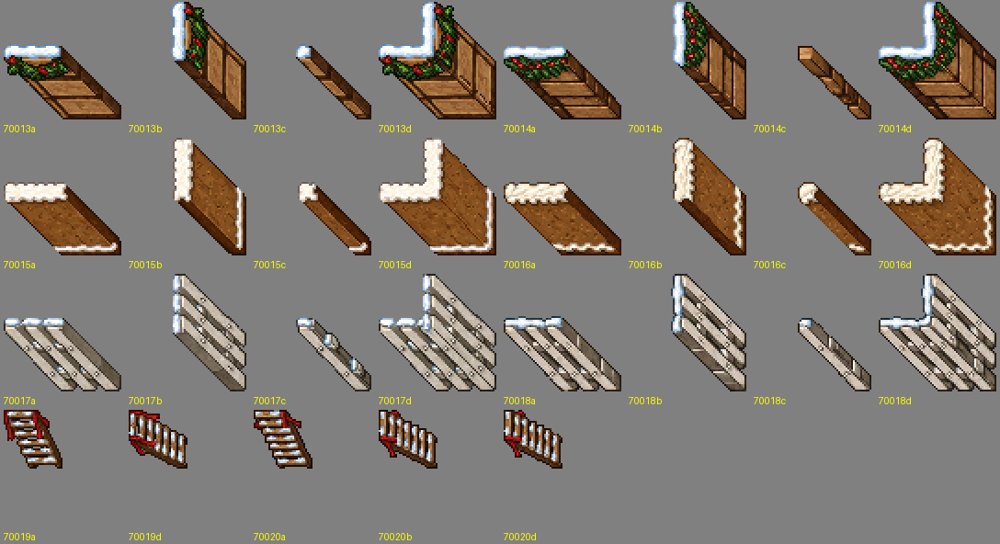
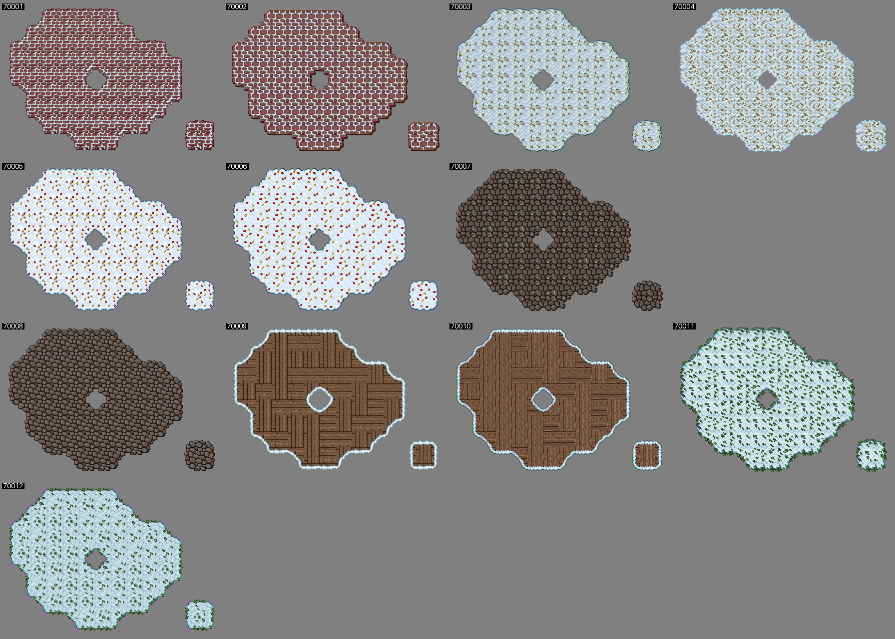
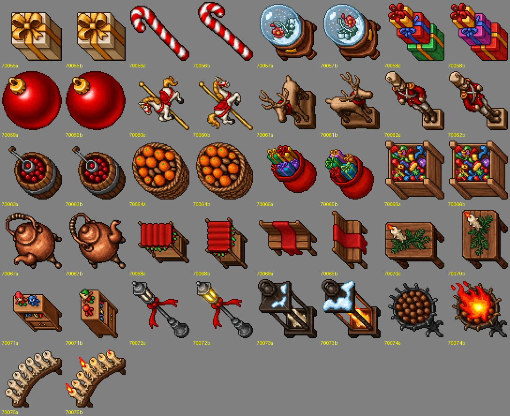
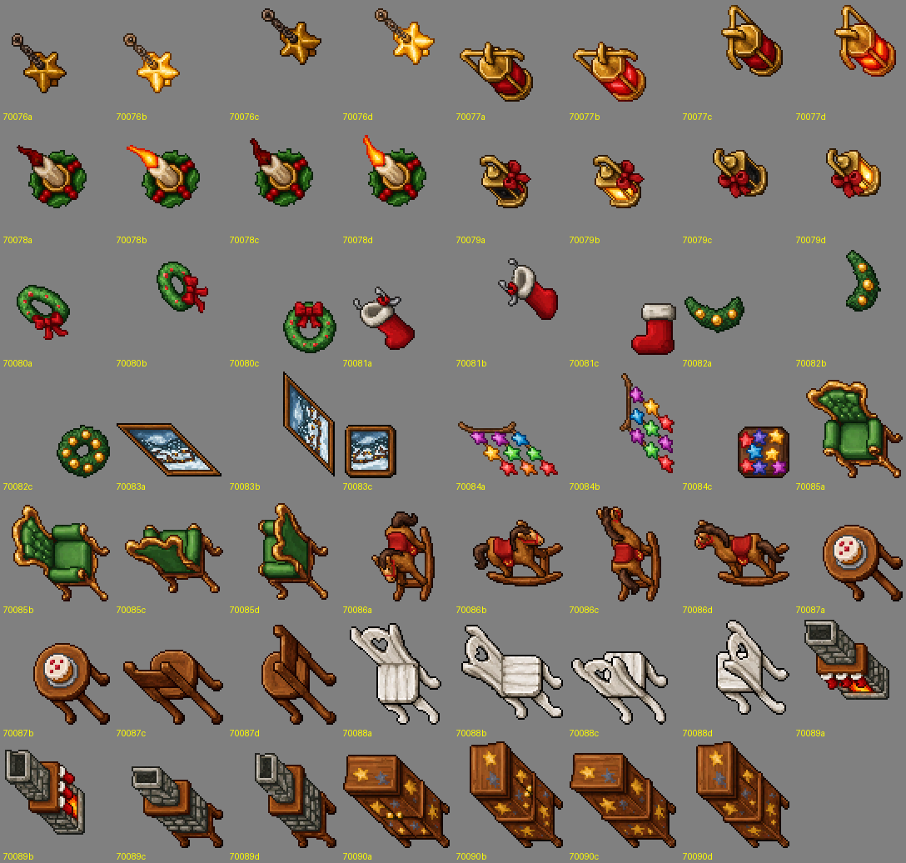
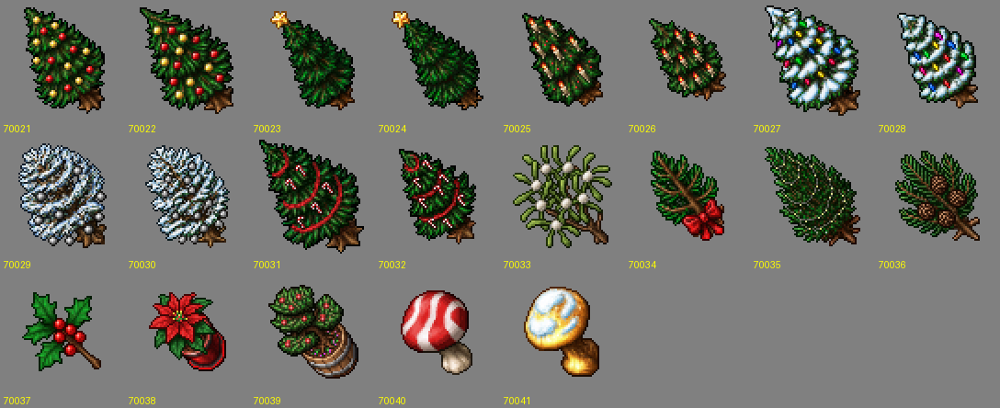
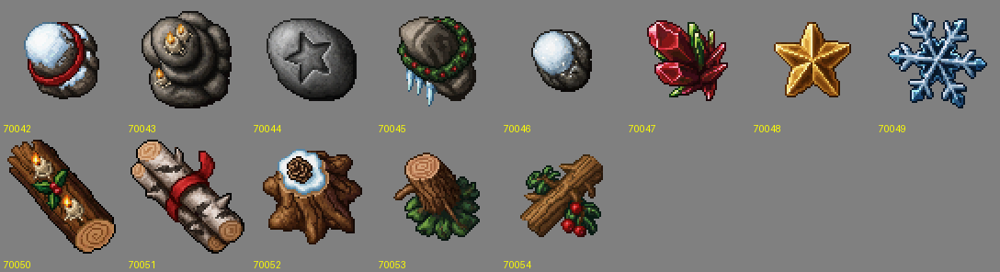
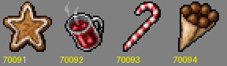

# Biome example: jarmark (Christmas market)

Ready prompts for the old PixelArt LoRAs and the sprites they produced, so each result can be traced back to its
prompt. Generated 2026-11-19 on a RunPod pod (Krea-2 Turbo bf16, 8 steps, CFG 1, LoRA strength 1.0), then
post-processed to game size with `tools/postprocess.py`. Only the sprites that were kept are shown.

How to read it: `<lora>-prompts.txt` has one prompt per line; `--d` is the seed. `examples/<lora>.png` shows every kept
sprite at 2x game size with its seed written under it (a letter after the seed is the part of a multi-part sheet,
e.g. a, b, c, d for the four wall parts). Ground shows each sheet assembled into an island: the four ground variants
plus matching border edges, outer corners and inner corners, with a single-tile sample next to it.

To generate them again: `sh pod/generate.sh loras/Krea2-PixelArt-<lora>.safetensors prompts/biomes/jarmark/<lora>-prompts.txt results/jarmark-<lora>`

## walls

Prompts: [`walls-prompts.txt`](walls-prompts.txt), sprites: [`examples/walls.png`](examples/walls.png)

| seed | what the prompt asks for | on the sheet |
|---|---|---|
| 70013 | wooden market hut wall with snow and a pine garland | yes |
| 70014 | wooden market hut wall with snow and a pine garland | yes |
| 70015 | brown gingerbread wall with white icing trim | yes |
| 70016 | brown gingerbread wall with white icing trim | yes |
| 70017 | low white picket fence with snow | yes |
| 70018 | low white picket fence with snow | yes |
| 70019 | wooden steps with snow and red ribbons | yes |
| 70020 | wooden steps with snow and red ribbons | yes |

## ground

Prompts: [`ground-prompts.txt`](ground-prompts.txt), sprites: [`examples/ground.png`](examples/ground.png)

| seed | what the prompt asks for | on the sheet |
|---|---|---|
| 70001 | red brick pavement covered with thin snow | yes |
| 70002 | red brick pavement covered with thin snow | yes |
| 70003 | trampled snow with scattered straw | yes |
| 70004 | trampled snow with scattered straw | yes |
| 70005 | white snow with red and gold confetti | yes |
| 70006 | white snow with red and gold confetti | yes |
| 70007 | frozen dark cobblestone with salt grains | yes |
| 70008 | frozen dark cobblestone with salt grains | yes |
| 70009 | wooden boardwalk with snow on the edges | yes |
| 70010 | wooden boardwalk with snow on the edges | yes |
| 70011 | green pine needles scattered on snow | yes |
| 70012 | green pine needles scattered on snow | yes |

## pairs

Prompts: [`pairs-prompts.txt`](pairs-prompts.txt), sprites: [`examples/pairs.png`](examples/pairs.png)

| seed | what the prompt asks for | on the sheet |
|---|---|---|
| 70055 | large wrapped gift box with a gold bow | yes |
| 70056 | tall red and white candy cane pole | yes |
| 70057 | snow globe on a wooden stand | yes |
| 70058 | stack of colorful wrapped presents | yes |
| 70059 | giant shiny red ornament ball with a gold cap | yes |
| 70060 | carousel horse on a golden pole | yes |
| 70061 | wooden reindeer with a red collar | yes |
| 70062 | tall wooden toy soldier with a red coat | yes |
| 70063 | barrel of mulled wine with a ladle | yes |
| 70064 | wicker basket of oranges and nuts | yes |
| 70065 | red sack full of presents | yes |
| 70066 | wooden crate full of colorful toys | yes |
| 70067 | large copper kettle on legs | yes |
| 70068 | market stall with a red roof and a garland | yes |
| 70069 | wooden bench with a red blanket | yes |
| 70070 | wooden table with candles and pine branches | yes |
| 70071 | small wooden shelf with toy figures | yes |
| 70072 | tall street lamp with a red ribbon | yes |
| 70073 | lantern with a candle and snow on top | yes |
| 70074 | iron fire bowl with roasting chestnuts | yes |
| 70075 | wooden candle arch with seven candles | yes |

## sheets

Prompts: [`sheets-prompts.txt`](sheets-prompts.txt), sprites: [`examples/sheets.png`](examples/sheets.png)

| seed | what the prompt asks for | on the sheet |
|---|---|---|
| 70076 | golden star shaped hanging lamp | yes |
| 70077 | red glass lantern with a gold frame | yes |
| 70078 | candle in a ring of holly | yes |
| 70079 | brass lantern with a red bow | yes |
| 70080 | green wreath with a red bow | yes |
| 70081 | red stocking hanging on a hook | yes |
| 70082 | pine garland with golden balls | yes |
| 70083 | framed painting of a snowy village | yes |
| 70084 | string of colorful paper stars | yes |
| 70085 | green velvet armchair with gold trim | yes |
| 70086 | painted wooden rocking horse with a red saddle | yes |
| 70087 | small wooden table with a cake | yes |
| 70088 | white painted chair with a heart cutout | yes |
| 70089 | stone fireplace with red stockings and a fire | yes |
| 70090 | tall wooden cupboard with painted stars | yes |

## flora

Prompts: [`flora-prompts.txt`](flora-prompts.txt), sprites: [`examples/flora.png`](examples/flora.png)

| seed | what the prompt asks for | on the sheet |
|---|---|---|
| 70021 | pine tree decorated with red and gold balls | yes |
| 70022 | pine tree decorated with red and gold balls | yes |
| 70023 | tall fir tree with a gold star on top | yes |
| 70024 | tall fir tree with a gold star on top | yes |
| 70025 | small fir tree with lit candles | yes |
| 70026 | small fir tree with lit candles | yes |
| 70027 | snowy pine with colorful light bulbs | yes |
| 70028 | snowy pine with colorful light bulbs | yes |
| 70029 | white frosted tree with silver baubles | yes |
| 70030 | white frosted tree with silver baubles | yes |
| 70031 | pine tree with red ribbons and candy canes | yes |
| 70032 | pine tree with red ribbons and candy canes | yes |
| 70033 | mistletoe bunch with white berries | yes |
| 70034 | small pine sapling with a red bow | yes |
| 70035 | evergreen bush with tiny lights | yes |
| 70036 | bundle of pine branches with pinecones | yes |
| 70037 | holly sprig with red berries | yes |
| 70038 | red pot with a red poinsettia | yes |
| 70039 | wooden tub with a small decorated pine | yes |
| 70040 | red and white striped candy mushroom | yes |
| 70041 | golden glowing mushroom with snow on its cap | yes |

## nature

Prompts: [`nature-prompts.txt`](nature-prompts.txt), sprites: [`examples/nature.png`](examples/nature.png)

| seed | what the prompt asks for | on the sheet |
|---|---|---|
| 70042 | snowy boulder tied with a red ribbon | yes |
| 70043 | stack of stones with small candles | yes |
| 70044 | smooth grey stone with a carved star | yes |
| 70045 | rock with icicles and a pine garland | yes |
| 70046 | round snowy rock with tiny lights | yes |
| 70047 | red and green crystal cluster | yes |
| 70048 | golden crystal shaped like a five pointed star | yes |
| 70049 | blue and silver snowflake shaped crystal | yes |
| 70050 | yule log with holly and candles | yes |
| 70051 | birch logs tied with a red ribbon | yes |
| 70052 | old tree stump topped with snow and a pinecone | yes |
| 70053 | cut pine trunk with green branches | yes |
| 70054 | fallen pine branch with red berries | yes |

## consumables

Prompts: [`consumables-prompts.txt`](consumables-prompts.txt), sprites: [`examples/consumables.png`](examples/consumables.png)

| seed | what the prompt asks for | on the sheet |
|---|---|---|
| 70091 | star shaped gingerbread cookie with white icing | yes |
| 70092 | steaming mug of red mulled wine | yes |
| 70093 | red and white candy cane | yes |
| 70094 | roasted chestnuts in a paper cone | yes |

